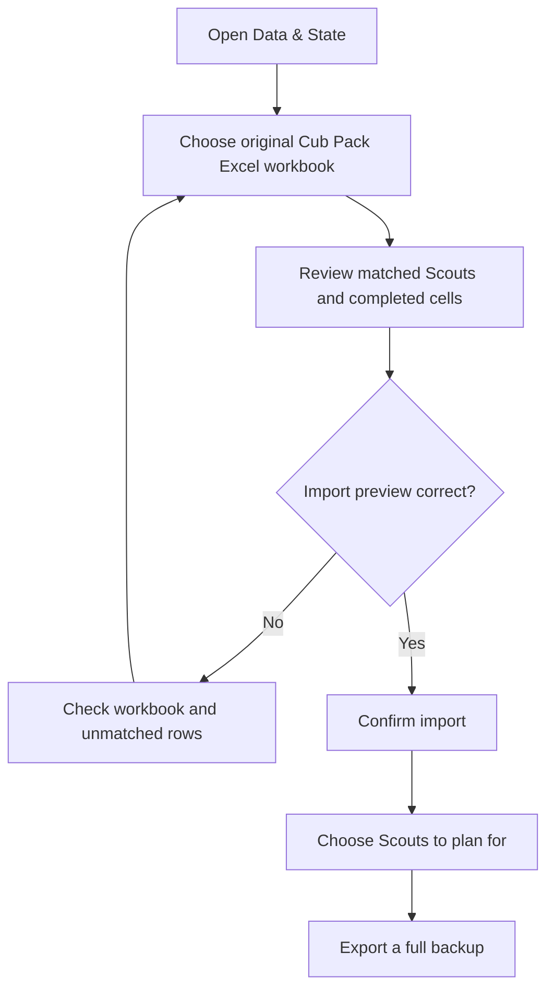
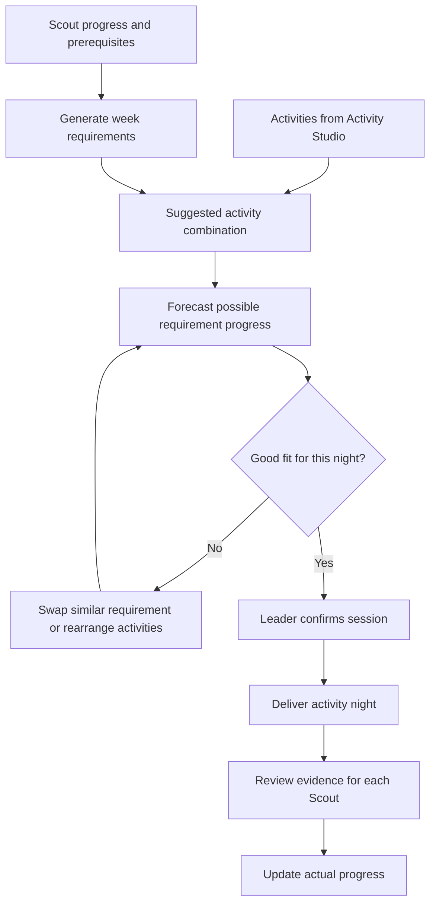
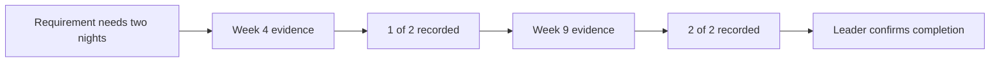
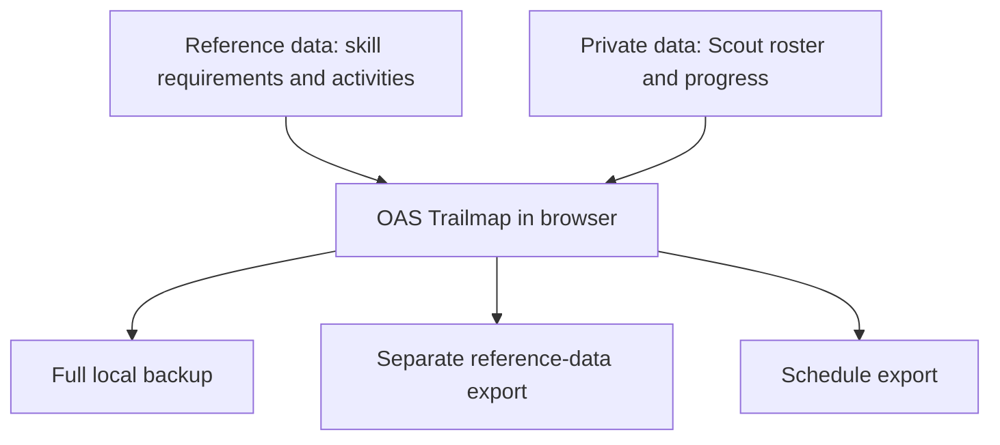

# OAS Trailmap — practical workflows

This guide is written for Scout leaders. You do not need to understand YAML, JSON or GitHub to use the app.

## Setting up progress for the first time

The original Excel workbook import is the supported way to initialise Scout achievement records. The import recognises highlighted completion cells and dates, and does not silently clear achievements already recorded.

## Planning a night

A schedule is a **proposal**. Forecasts assume that the planned activities happen, the Scout attends and successfully demonstrates the skills, and the leader confirms evidence afterward. Actual progress is not awarded by forecasting.

## Requirements requiring several different nights

The requirements dataset has `required_occurrences`, `occurrence_unit` and `occurrence_basis`. An explicit count comes from wording such as *at least two bushwalking activities*. An inferred count is a planning guess, not a new official OAS requirement. You can review counts in the Skill Tree Mapper or `data/requirements.txt`. Distinct weeks are counted separately.

## Understanding the forecast

The scheduler shows a line chart of *average fully completed requirements per selected Scout*. The line begins with recorded progress. It rises only when the final planned evidence opportunity for a requirement is reached and its prerequisites can be satisfied. Individual experiences such as two bushwalks may fill separate weeks. The graph is useful for comparisons, not as proof of achievement.

## Safely replacing a planned requirement

1. Open the Scheduler and find the relevant week.
2. Select **Swap similar** beside the requirement.
3. Compare related suggestions with overlapping tags, compatible locations and prerequisite readiness.
4. Choose a replacement, then select **Apply replacement**.
5. The edited week locks to avoid being replaced by the next regeneration. Unlock it if you want a fresh schedule.
6. Review the forecast again, including any repeated-night gaps.

## Appendix: shared versus private data

GitHub hosts application source and nonpersonal reference data. Scout records remain local unless a leader explicitly exports them. A full backup can include Scout information; handle it appropriately.
